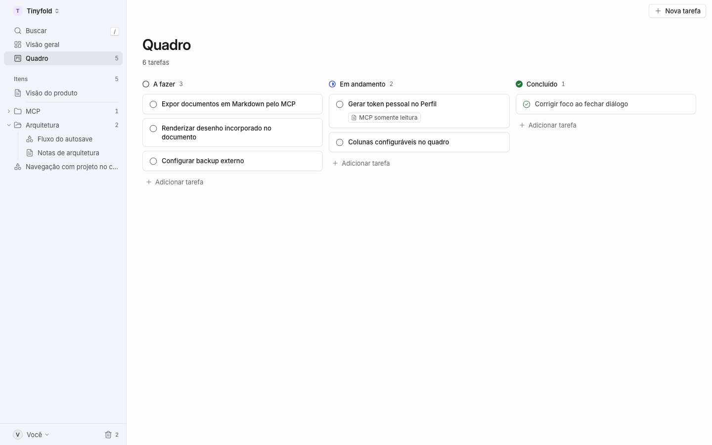
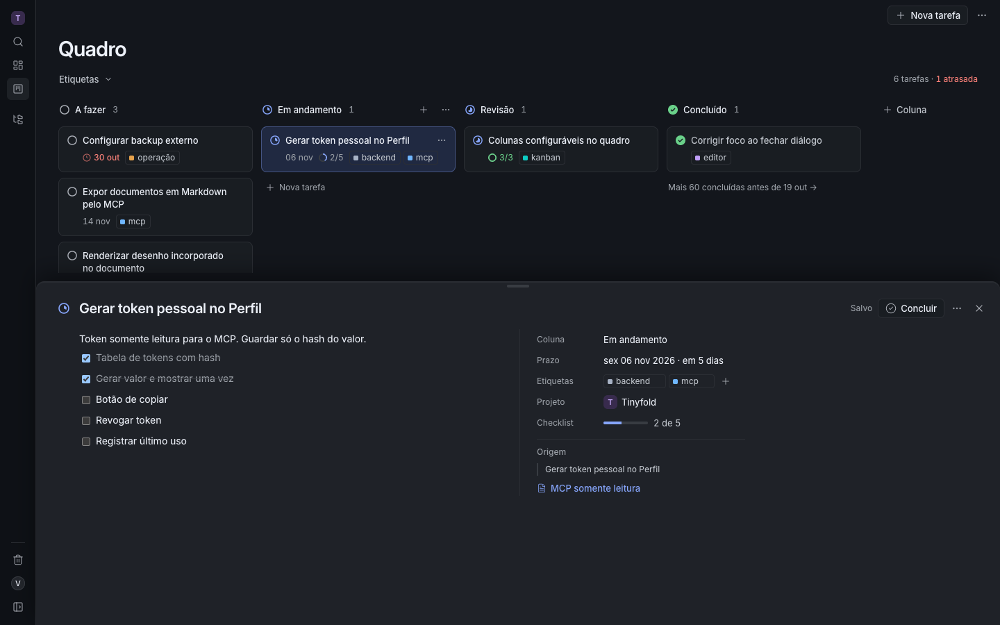
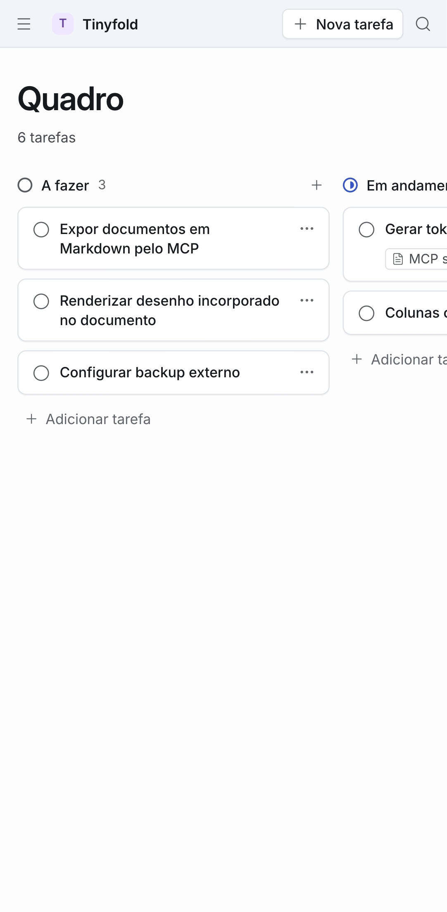
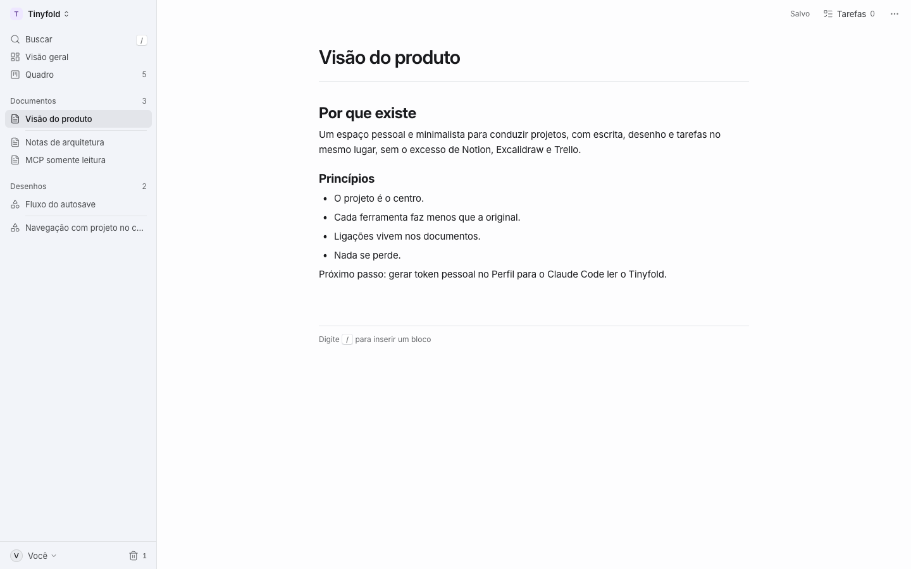
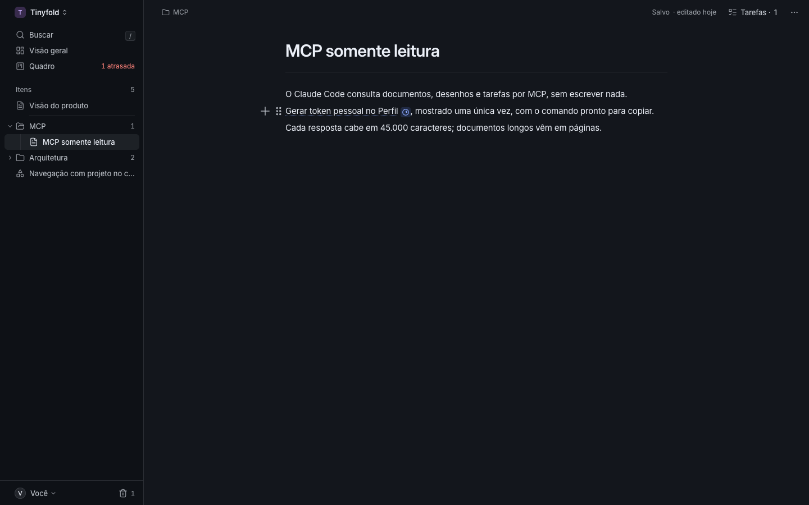
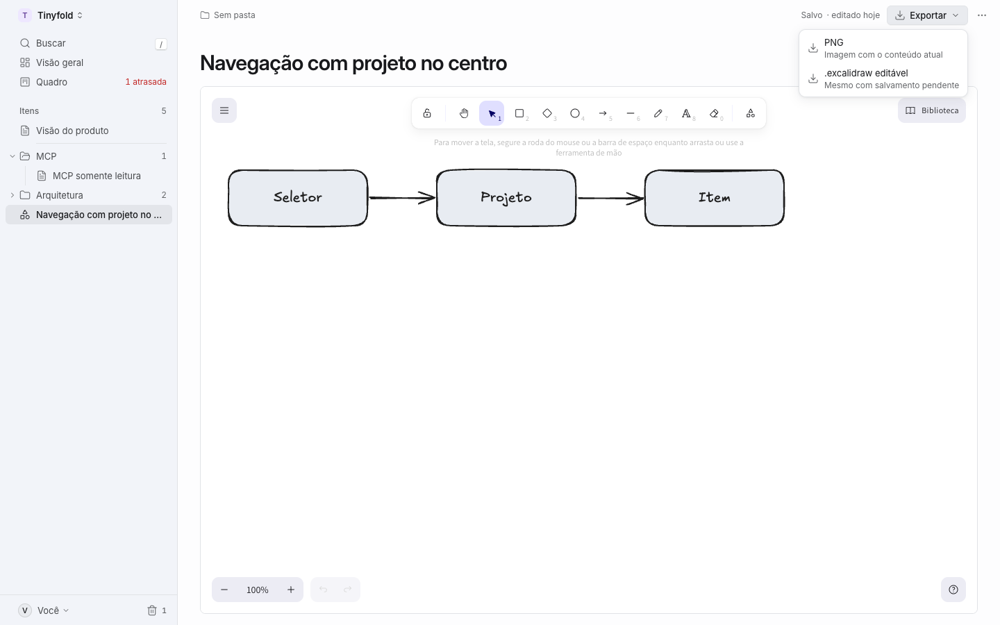
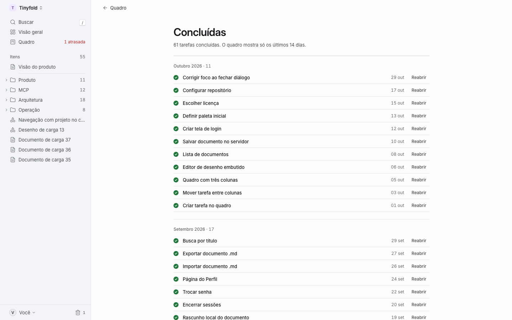

# Tinyfold

Um espaço pessoal e minimalista para conduzir projetos: escrever, desenhar e acompanhar tarefas em Kanban no mesmo lugar, sempre dentro de um projeto. Interface Sumário, limpa e tipográfica, em tema claro e escuro, com dados em SQLite no servidor e autenticação por senha.

**Estado:** implementado até a [etapa 11](docs/etapas/11-documento-desenho.md) e implantado no Railway, com SQLite persistente e uma instalação iniciada vazia. Disponível em [folder.jalzn.com](https://folder.jalzn.com), com DNS, HTTPS e login verificados. Snapshot remoto baixado e restauração verificada; backups automáticos externos continuam pendentes. Ver [operação no Railway](docs/railway.md).

## O que funciona

- Tudo dentro de um projeto: o aplicativo reabre onde você parou, com a lateral do projeto (seletor, Buscar, Visão geral, Quadro e a árvore Itens), a faixa recolhida com o popover Itens e a lateral sobre a página em telas menores.
- Pastas de um nível para documentos e desenhos: criar, renomear, reordenar e excluir na lateral, mover arrastando ou por "Mover para pasta…" (M), e a pasta no cabeçalho do item, no ⌘K, no Índice, na Visão geral e na Lixeira.
- Projetos com cor e ordem, arquivamento e até oito itens fixados na raiz e em cada pasta; mover documentos e desenhos entre pastas e projetos, com Desfazer no toast e por ⌘Z.
- Visão geral, Índice do projeto e Lixeira por projeto, com restaurar, excluir de vez e esvaziar.
- ⌘K para buscar em todos os projetos e rodar comandos, atalhos de teclado e Esc que fecha só a camada mais recente.
- Tema Sistema, Claro ou Escuro, sem piscar ao carregar.
- Documentos com editor visual em blocos, atalhos Markdown e importação/exportação `.md`, na página Sumário: a coluna de 680 px, a barra com o salvamento ("Salvo · editado hoje"), "Tarefas · n" e o ⋯, e as faixas fixas.
- Tarefas e desenhos incorporados nos documentos, pelo menu `/` ou pelo ⌘K, de qualquer projeto ativo. O card da tarefa mostra coluna, prazo, etiquetas e checklist ao vivo e abre a gaveta; a figura mostra o desenho na versão atual e abre o editor. Itens na lixeira ou excluídos ficam indisponíveis, com Restaurar e Remover. As setas chegam aos incorporados um bloco por vez, e o `.md` exportado os leva como links.
- Equações LaTeX em linha e em bloco, com prévia e preservação da fonte no Markdown.
- Salvamento automático, recuperação de rascunhos e resolução explícita de conflitos entre dispositivos.
- Desenhos com Excalidraw: formas, setas, texto e traço livre; importação/exportação `.excalidraw` e exportação PNG pelo "Exportar ▾" da barra.
- Quadro do projeto com colunas configuráveis, as mesmas em todos os projetos: criar, renomear, reordenar, excluir com destino e escolher a coluna de conclusão, com Desfazer. Cards com prazo, atraso, etiquetas e progresso do checklist; mover arrastando, pelo teclado ou pelo menu; filtro por etiqueta.
- Gaveta da tarefa, que empurra a página e fica aberta durante a navegação: coluna, prazo com calendário, etiquetas, projeto e a descrição com o editor dos documentos, salvamento automático e rascunho recuperável. ⌘↵ conclui ou reabre, com Desfazer.
- Concluídas por mês, as atrasadas na Visão geral, no seletor e na lateral, e as datas no fuso do dono, que o Perfil troca.
- Criar tarefa a partir de um trecho (⌘⌥T), com o card incorporado logo abaixo e um marcador no fim do trecho que abre a tarefa, e voltar ao documento de origem.
- Perfil com troca de senha, gerenciamento de sessões e tokens pessoais para o Claude Code.
- Acesso do Claude Code por MCP somente leitura: lista projetos com as pastas, busca, lê documentos em Markdown, com as tarefas e os desenhos incorporados como links, desenhos como imagem e estrutura, e tarefas com coluna, prazo, etiquetas, checklist e a descrição. A lixeira fica de fora.

| Quadro | Gaveta da tarefa | Celular |
| --- | --- | --- |
|  |  |  |

| Documento com incorporados | Marcador de origem | Desenho |
| --- | --- | --- |
|  |  |  |

| Visão geral | Pastas | Concluídas |
| --- | --- | --- |
|  |  |  |

Mais capturas, nos dois temas e em três larguras, estão na validação das etapas [11](docs/validacao.md#etapa-11-documento-e-desenho), [10](docs/validacao.md#etapa-10-quadro-e-tarefa), [09](docs/validacao.md#etapa-09-pastas) e [08](docs/validacao.md#etapa-08-fundação-e-lateral).

## Executar

```sh
mise install
mise exec -- pnpm install
cp .env.example .env
```

Defina `OWNER_PASSWORD` em `.env` antes da primeira subida, com pelo menos 12 caracteres. A conta é criada uma vez; depois use o Perfil ou o comando de recuperação para trocar a senha.

```sh
mise exec -- pnpm dev
```

Abra [localhost:5170](http://localhost:5170). O SQLite fica em `data/tinyfold.sqlite`, fora do Git. O servidor aplica migrações automaticamente.

## Verificar

```sh
mise exec -- pnpm check
mise exec -- pnpm test:db
mise exec -- pnpm build
mise exec -- pnpm e2e
```

Os testes E2E usam Google Chrome instalado e bancos temporários isolados, em desktop e emulação de celular. Em uma máquina sem Chrome, instale-o com `pnpm exec playwright install --with-deps chrome`.

Se a porta padrão dos testes estiver ocupada, use `E2E_PORT=5172 mise exec -- pnpm e2e`. Cada execução continua usando seu próprio banco temporário.

## Documentação

| Documento | Conteúdo |
| --- | --- |
| [Produto](docs/produto.md) | Experiência, navegação e limites |
| [Arquitetura](docs/arquitetura.md) | Módulos, rotas e shell, tema, autenticação, SQLite, salvamento e MCP |
| [Equações](docs/equacoes.md) | Inserir, editar e importar/exportar fórmulas LaTeX |
| [Stack](docs/stack.md) | Tecnologias e adaptações do Orbis |
| [Identidade visual](docs/identidade-visual.md) | Direção escolhida e referência do Claude |
| [Interface](docs/interface/README.md) | Interface Sumário: especificações, protótipo e o que falta implementar |
| [Operação](docs/implantacao.md) | Docker, configuração, senha, backups e Claude Code |
| [Railway e Cloudflare](docs/railway.md) | Primeiro deploy, volume SQLite, subdomínio, HTTPS e backups |
| [Validação](docs/validacao.md) | Testes executados, Chrome e revisões adversariais |
| [Etapas](docs/etapas/README.md) | Estado das entregas |
| [Decisões](docs/decisoes.md) | Histórico de produto e implementação |

Equipes, colaboração em tempo real, anexos e sincronização offline completa ficam fora desta versão. Desenhos aceitam elementos vetoriais; imagens e conteúdo incorporado dentro de um desenho ainda não estão habilitados. Markdown e `.excalidraw` são formatos de intercâmbio; o backup SQLite preserva o aplicativo completo.
